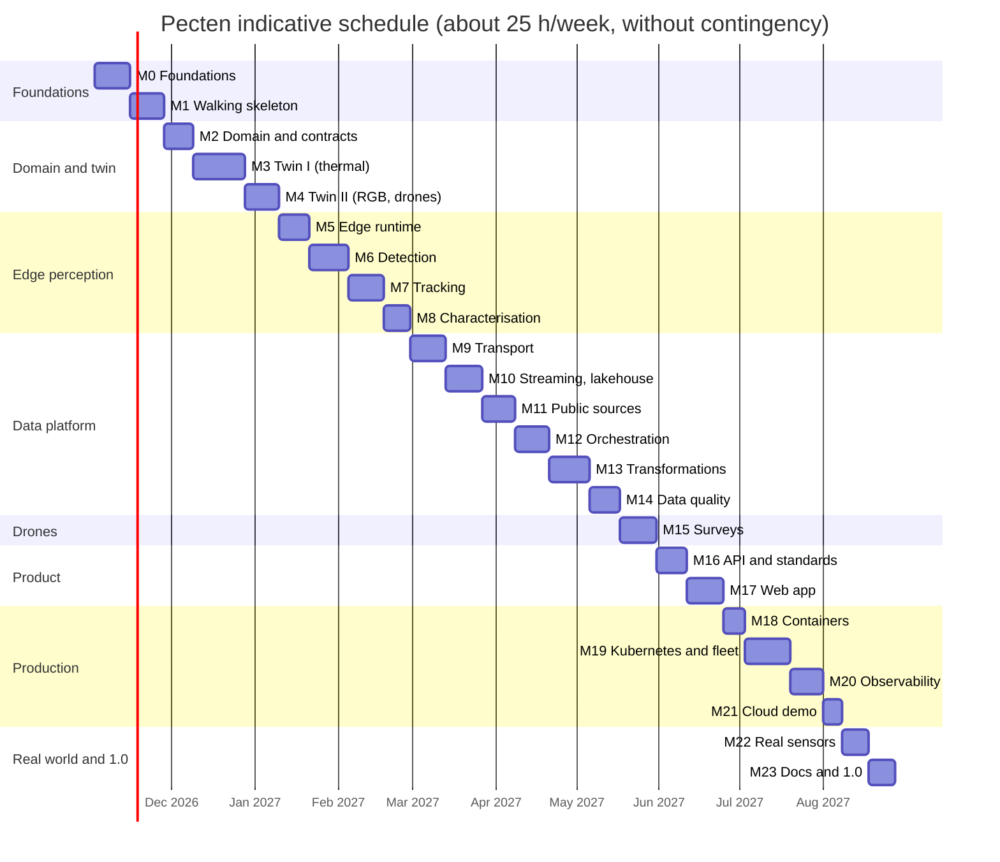
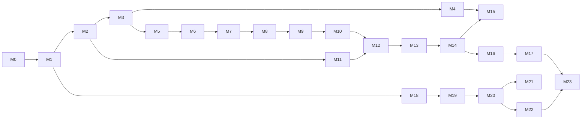

# Roadmap

> **Status (2026-11-02):** planning is complete and the engineering foundations (M0) are being
> built. Research, architecture and sixteen ADRs are in [`docs/`](docs/). The next item is **M0.12**.

Pecten is built in nine phases and 24 milestones. A thin end-to-end slice comes first (M1), and
every later milestone deepens one stage of that slice, so the system works from early on and gets
better with each step.

## How to read this roadmap

- **IDs** are `M<milestone>.<item>` (stretch goals `S<n>`). Every milestone exists on GitHub
  and every open item is an [issue](https://github.com/soheil-mp/pecten/issues) titled by its ID.
  `just sync-issues --apply` keeps them in step with this file, which stays the source of truth.
- **Estimates** are hours of focused work, including tests and documentation for that item.
- **`[x]`** marks items merged to `main`. A milestone closes only when its exit criteria hold.
- Background for every decision: [domain research](docs/research/01-domain.md),
  [data sources](docs/research/02-data-sources.md),
  [technology landscape](docs/research/03-technology-landscape.md),
  [architecture](docs/architecture.md) and the [ADRs](docs/adr/README.md).

## Summary

| Phase | Milestone | Hours | Release |
| :-- | :-- | --: | :-- |
| 0. Foundations | [M0 Engineering foundations](#m0--engineering-foundations) | 45 | |
| 1. Walking skeleton | [M1 Thin end-to-end slice](#m1--thin-end-to-end-slice-thermal) | 48 | v0.1.0 |
| 2. Domain and sensor twin | [M2 Domain model, geometry, time and contracts](#m2--domain-model-geometry-time-and-contracts) | 38 | |
| | [M3 Sensor twin I: scenes, birds and thermal](#m3--sensor-twin-i-scenes-birds-and-the-thermal-camera) | 67 | v0.2.0 |
| | [M4 Sensor twin II: visible light, stereo and drones](#m4--sensor-twin-ii-visible-light-stereo-and-drones) | 47 | |
| 3. Perception on the edge | [M5 Edge runtime and frame ingestion](#m5--edge-runtime-and-frame-ingestion) | 39 | |
| | [M6 Detection](#m6--detection) | 55 | |
| | [M7 Multi-target tracking](#m7--multi-target-tracking) | 47 | |
| | [M8 Flight characterisation and explainable rules](#m8--flight-characterisation-and-explainable-rules) | 37 | v0.3.0 |
| 4. Data platform | [M9 Edge-to-platform transport and fleet identity](#m9--edge-to-platform-transport-and-fleet-identity) | 45 | |
| | [M10 Streaming and the lakehouse](#m10--streaming-and-the-lakehouse) | 50 | |
| | [M11 Public-source ingestion](#m11--public-source-ingestion) | 44 | |
| | [M12 Orchestration with Airflow 3](#m12--orchestration-with-airflow-3) | 45 | |
| | [M13 Transformations and analytics](#m13--transformations-and-analytics-with-sqlmesh) | 53 | |
| | [M14 Data quality and contracts in operation](#m14--data-quality-and-contracts-in-operation) | 38 | v0.4.0 |
| 5. Drone surveys | [M15 Drone survey planning and processing](#m15--drone-survey-planning-and-processing) | 51 | v0.5.0 |
| 6. Product surface | [M16 Read API and standards](#m16--read-api-and-standards) | 41 | |
| | [M17 Web application](#m17--web-application) | 49 | v0.6.0 |
| 7. Production engineering | [M18 Containers and supply chain](#m18--containers-and-supply-chain) | 30 | |
| | [M19 Kubernetes, GitOps and the edge fleet](#m19--kubernetes-gitops-and-the-edge-fleet) | 60 | |
| | [M20 Observability and SRE](#m20--observability-and-sre) | 42 | |
| | [M21 Infrastructure as code: optional cloud demo](#m21--infrastructure-as-code-an-optional-cloud-demo) | 25 | v0.7.0 |
| 8. Real world and 1.0 | [M22 Real-sensor readiness](#m22--real-sensor-readiness) | 36 | |
| | [M23 Documentation, write-up and 1.0](#m23--documentation-write-up-and-10) | 35 | v1.0.0 |
| | **Total** | **1,067** | |
| | [Stretch goals S1–S10](#stretch-goals) | 110 | |

**Done:** 47 h (M0.1, M0.2, M0.3, M0.4, M0.5, M0.6, M0.7, M0.8, M0.9, M0.10, M0.11, M0.13, M1.1). **Open:** 1,020 h. With 15 % contingency that is about
1,180 hours: roughly 11 months at 25 hours a week, before the stretch goals.

### Indicative schedule

### Dependencies

The schedule is sequential for one developer, but only these edges are hard dependencies, so
M11, M15 and M18 can move earlier if useful.

## Principles

1. **Deterministic and explainable.** No learned models; every result carries its reasons
   ([ADR-0002](docs/adr/0002-deterministic-explainable-perception.md)).
2. **Physics first.** The sensor twin is the reference for every test
   ([ADR-0003](docs/adr/0003-physics-based-sensor-twin.md)).
3. **Privacy is architecture.** Frames stay on the device; third-party data is minimised before
   it is stored ([ADR-0004](docs/adr/0004-privacy-by-design-for-cameras.md)).
4. **Small data by design.** Reduce at the edge, regenerate instead of storing, budget every
   table ([ADR-0013](docs/adr/0013-small-data-by-design.md)).
5. **Contracts first.** Schemas and data contracts change before the code that uses them
   ([ADR-0011](docs/adr/0011-contracts-first.md)).
6. **Standards out.** Results leave in formats other tools already read
   ([ADR-0016](docs/adr/0016-standards-based-outputs.md)).
7. **Everything as code.** Infrastructure, policies, dashboards, alerts and repository settings.
8. **Honest science.** Limitations and simulation gaps are written next to the results.

## Definition of done (every item)

- [ ] Merged by pull request with CI green and Conventional Commit messages.
- [ ] Tests at the right level (unit, property, scenario, integration, end to end); coverage does
      not drop.
- [ ] Ruff, `mypy --strict`, rustfmt, Clippy (`-D warnings`) and the dependency policy pass.
- [ ] Documentation updated: reference for interfaces, a how-to for anything a user runs.
- [ ] Schemas and contracts updated; breaking changes versioned.
- [ ] No secrets, no personal data, byte budgets respected.
- [ ] An ADR added or superseded if a recorded decision changes.
- [ ] This file ticked, and README.md updated if the change affects it.

---

## Phase 0: Foundations

### M0 · Engineering foundations

**Goal:** a polyglot repository where every later change is linted, typed, tested, documented and
released automatically.

- [x] **M0.1** (2 h) Repository bootstrap: MIT licence, `.gitignore`, `.editorconfig`,
  `.gitattributes`, `.env.example`, pre-commit with gitleaks, codespell, markdownlint and
  Conventional Commits.
- [x] **M0.2** (8 h) Planning: domain research, data sources verified against the live services,
  technology landscape, sixteen ADRs, architecture and this roadmap.
- [x] **M0.3** (4 h) Cargo workspace: `rust-toolchain.toml` (Rust 1.99, edition 2024); crates
  `pecten-vision`, `pecten-edge`, `pecten-gateway`, `pecten-proto` and `pecten-py`; workspace
  lints (Clippy pedantic with documented exceptions, `unsafe_code = "forbid"` outside
  `pecten-py`); rustfmt settings; cargo-nextest and cargo-llvm-cov.
- [x] **M0.4** (4 h) uv workspace: Python 3.14 pin and `uv.lock`; packages `pecten-sim`,
  `pecten-ingest`, `pecten-pipelines`, `pecten-survey`, `pecten-api` and `pecten-contracts`;
  Ruff, `mypy --strict`, pytest with Hypothesis, branch coverage failing under 85 %, and
  import-linter contracts.
- [x] **M0.5** (3 h) Tool pinning and tasks: `mise.toml` (just, buf, kubectl, Helm, k3d, kind,
  OpenTofu, Node, pnpm); `justfile` with `setup`, `fmt`, `lint`, `typecheck`, `test`, `bench`,
  `docs`, `up`, `down` and `e2e`; a devcontainer with the same versions.
- [x] **M0.6** (2 h) Code hooks in pre-commit: Ruff, mypy, rustfmt, Clippy, `buf lint`,
  actionlint, hadolint, ShellCheck, yamllint, check-jsonschema, taplo and import-linter.
- [x] **M0.7** (6 h) GitHub Actions CI: path filters; jobs for Rust, Python, Protobuf, docs and
  hooks; Rust and uv caches; concurrency groups; read-only default token; actions pinned by
  commit SHA; coverage in the job summary; one arm64 job; one aggregate `ci-passed` check.
- [x] **M0.8** (3 h) Dependency policy: Renovate (grouped, scheduled, digest pinning, custom
  managers for `mise.toml`); `tools/dependency_policy.py` (licence allowlist and machine-learning
  deny list for Python and JavaScript lock files); `deny.toml` for cargo-deny (licences, bans,
  sources); run in CI, pre-commit and `just lint`.
- [x] **M0.9** (2 h) Community files: `CONTRIBUTING.md`, `CODE_OF_CONDUCT.md` (Contributor
  Covenant 2.1), `CODEOWNERS`, issue forms (bug, feature, research spike) and a pull-request
  template that asks about ADRs, contracts and privacy.
- [x] **M0.10** (3 h) Release automation: release-please in manifest mode for crates, packages
  and the web app; `CHANGELOG.md`; tags `vX.Y.Z`; `CITATION.cff`; a versioning policy for APIs,
  schemas and contracts.
- [x] **M0.11** (3 h) Documentation site with Zensical: Diátaxis sections, research and ADRs
  included, Mermaid enabled, deployed to GitHub Pages, lychee link checking in CI.
- [ ] **M0.12** (3 h) Repository settings as code with OpenTofu (`integrations/github`):
  description, topics, labels, merge-commit-only merging, secret scanning with push protection,
  private vulnerability reporting, and rulesets (no force-push or deletion; pull requests must
  pass `ci-passed`). State stays local and ignored by Git.
- [x] **M0.13** (2 h) `tools/sync_roadmap_issues.py`: idempotent creation of GitHub milestones,
  labels and one issue per open roadmap item; closes issues whose items are ticked here.

**Exit criteria:** CI is green on `main`; the docs site is live; `just setup && just test` works
on a fresh clone.

---

## Phase 1: Walking skeleton

### M1 · Thin end-to-end slice (thermal)

**Goal:** one synthetic warm bird crossing a thermal camera's view becomes a gold-table row and an
API response, in Docker Compose and in CI.

- [x] **M1.1** (5 h) Minimal thermal simulator: uniform sky, Gaussian NETD noise, one warm disc on
  a straight line, 160 × 120 pixels at 8.7 Hz; frames as an Arrow IPC stream over TCP; ground
  truth as JSON Lines on a separate channel.
- [ ] **M1.2** (3 h) First Protobuf schemas (`FrameHeader`, `DetectionBatch`, `TrackUpdate`,
  `TrackClosed`, all v1) with `buf lint` and `buf breaking` in CI; Rust and Python code
  generation.
- [ ] **M1.3** (6 h) Minimal edge: Arrow IPC reader, fixed threshold, connected components,
  nearest-neighbour tracker, CloudEvents in binary mode over MQTT 5 (no TLS yet).
- [ ] **M1.4** (6 h) Compose profile `core`: Mosquitto 2.1, Kafka 4.4 (one KRaft node), Apicurio
  Registry 3.3, SeaweedFS, PostgreSQL and Lakekeeper 0.14 with a bootstrap job; health checks;
  configuration from `.env`.
- [ ] **M1.5** (5 h) Minimal gateway: MQTT shared subscription, decoding, idempotent Kafka
  producer with CloudEvents headers.
- [ ] **M1.6** (5 h) RisingWave Kafka source and Iceberg sink into `bronze.tracks_closed` through
  Lakekeeper.
- [ ] **M1.7** (5 h) SQLMesh project on Trino with one staging model, one gold model and one
  audit; one unit test on DuckDB.
- [ ] **M1.8** (3 h) Airflow 3.3 (standalone in Compose) with one asset-scheduled DAG that runs
  the SQLMesh models.
- [ ] **M1.9** (3 h) FastAPI endpoint `GET /v1/tracks` reading the gold model through Trino.
- [ ] **M1.10** (5 h) `just e2e`: start the stack, run a 60-second seeded scenario, and assert one
  track whose speed matches ground truth within 5 %; runs in CI in under 15 minutes.
- [ ] **M1.11** (2 h) Boundaries: import-linter contracts and cargo-deny bans stop edge code from
  depending on ground-truth modules or on the pipelines
  ([ADR-0003](docs/adr/0003-physics-based-sensor-twin.md)).

**Exit criteria:** `just e2e` passes locally and in CI; a "first run" tutorial documents the
slice. **Release v0.1.0.**

---

## Phase 2: Domain and sensor twin

### M2 · Domain model, geometry, time and contracts

**Goal:** a shared vocabulary, camera geometry and contracts that every later milestone builds on.

- [ ] **M2.1** (4 h) Domain glossary and entity model: site, rig, camera, deployment, frame,
  detection, track, observation, mission, survey and image; UUIDv7 identifiers; naming rules.
- [ ] **M2.2** (6 h) Camera geometry in `pecten-vision` with Python bindings: pinhole model,
  Brown–Conrady distortion, pose conventions (yaw, pitch, roll), and transforms between ENU,
  WGS 84, EPSG:28992 (RD New) and UTM 31N through PROJ; round-trip property tests.
- [ ] **M2.3** (3 h) Time model: event time versus ingest time, frame clocks, clock-sync status
  fields, skew policy, UTC storage and ISO 8601 exports.
- [ ] **M2.4** (2 h) Units policy: SI units with suffixes (`speed_mps`, `temp_k`), centi-kelvin on
  the wire for thermal frames, compile-time units in Rust with `uom`.
- [ ] **M2.5** (6 h) Protobuf catalogue v1 for every edge event
  ([architecture §4](docs/architecture.md#4-events-and-contracts)) with protovalidate rules and
  generated reference docs.
- [ ] **M2.6** (3 h) CloudEvents conventions (`type`, `source`, `subject`, `dataschema`,
  `traceparent`) and a conformance test suite shared by the edge and the gateway.
- [ ] **M2.7** (3 h) MQTT topic namespace, QoS and retention policy, retained device state and Last
  Will; Mosquitto ACL templates generated from the registry.
- [ ] **M2.8** (6 h) ODCS v3.2 contracts for the first bronze, silver, gold and reference tables:
  schema, quality rules, service levels, retention, byte budget and per-field privacy class;
  `datacontract lint` in CI.
- [ ] **M2.9** (5 h) Registry: sites, devices, calibrations, privacy masks and rule tables as YAML
  validated by JSON Schema; a loader into `ref.*` tables; a SOSA/SSN JSON-LD export.

**Exit criteria:** contracts and schemas lint in CI; the registry loads into `ref` tables; geometry
round-trips within 1 mm and 0.01 pixel.

### M3 · Sensor twin I: scenes, birds and the thermal camera

**Goal:** physically plausible thermal scenes with exact ground truth, for any weather.

- [ ] **M3.1** (5 h) Scenario language: YAML with Pydantic v2 models and a generated JSON Schema
  (site, time window, weather source, rigs, populations, distractors, seed); scenario hash.
- [ ] **M3.2** (6 h) Species reference: AviList v2025 names with AVONET mass, wing length and
  hand-wing index for a Western Palearctic species list; span and wing area derived with
  documented allometries.
- [ ] **M3.3** (10 h) Flight kinematics: allometric airspeeds, wind drift from Open-Meteo
  profiles, flapping, bounding, gliding and soaring (circling in thermals), flock formations;
  seeded per entity.
- [ ] **M3.4** (5 h) Wingbeat model: Pennycuick frequencies; stroke-phase modulation of projected
  area and apparent temperature.
- [ ] **M3.5** (10 h) Radiometry: Planck band radiance (8–14 µm), emissivity, a bird
  surface-temperature model, sky brightness temperature (Swinbank, Berdahl–Martin, cloud
  correction) and first-order atmospheric transmittance from humidity and visibility.
- [ ] **M3.6** (8 h) Thermal sensor models: a Lepton-3.5-like core and a 640 × 512 core; NETD
  noise, fixed-pattern noise, vignetting, flat-field-correction freezes and offsets, dead
  pixels, point-spread blur and lens distortion.
- [ ] **M3.7** (6 h) Distractors: insects near the lens, rain, cloud edges, aircraft, turbine
  blades with a warm nacelle, sea-surface reflections.
- [ ] **M3.8** (3 h) Synthetic people on paths for privacy tests: body-size ranges and 30–36 °C
  surfaces, no identities.
- [ ] **M3.9** (5 h) Ground-truth channel: per-frame visibility, occlusion and pixel footprint;
  utilities that match ground truth to edge events in tests.
- [ ] **M3.10** (5 h) Determinism and speed: per-entity PCG64DXSM streams, golden frame hashes,
  vectorised rendering at least 4× real time for 640 × 512 at 9 Hz, benchmarked in CI.
- [ ] **M3.11** (4 h) Scenario library v1: night migration over dunes, coastal turbine at dusk,
  insects-and-rain stress test, people-on-path privacy test.

**Exit criteria:** the four reference scenarios render deterministically; contrast changes with
weather as the radiometric model predicts (property tests). **Release v0.2.0.**

### M4 · Sensor twin II: visible light, stereo and drones

**Goal:** the remaining camera types, so every modality has test scenes.

- [ ] **M4.1** (8 h) Visible-light camera: sun position (NOAA algorithm), sky luminance gradient,
  exposure control, shot and read noise, motion blur by sub-frame integration.
- [ ] **M4.2** (5 h) Illumination dynamics: cloud shadows, sudden exposure changes, twilight,
  night with infrared illumination.
- [ ] **M4.3** (6 h) Nest-box and feeder scene: procedural background, visits driven by diel
  activity curves, perching and occlusion.
- [ ] **M4.4** (4 h) Sky-facing visible-migration scene: crossing flocks and soaring gulls against
  moving clouds.
- [ ] **M4.5** (10 h) Drone survey scene: procedural terrain textures (sand, dune grass, water),
  colony layouts from nest-spacing distributions, incubating birds, chicks and shadows; a thermal
  nadir variant with a diurnal ground-temperature cycle.
- [ ] **M4.6** (6 h) Drone camera and flight log: GSD, footprint, gimbal, GNSS and yaw errors,
  sidecar metadata; 16-bit thermal and 8-bit RGB stills in a budgeted local store.
- [ ] **M4.7** (5 h) Stereo thermal rig: two synchronised cameras, baseline, extrinsics with
  deliberate small errors, synchronisation jitter.
- [ ] **M4.8** (3 h) Calibration targets: synthetic checkerboard and heated-grid frames for
  intrinsic and extrinsic calibration tests.

**Exit criteria:** every modality in the architecture's per-modality table has at least one
reference scenario with ground truth.

---

## Phase 3: Perception on the edge

### M5 · Edge runtime and frame ingestion

**Goal:** a robust edge process that never blocks, never loses events silently, and works offline.

- [ ] **M5.1** (6 h) Runtime architecture: tokio tasks per stage, bounded channels, an explicit
  back-pressure policy (drop oldest, with counters) and a frame buffer pool.
- [ ] **M5.2** (8 h) Frame sources behind one trait: Arrow IPC stream, file replay and V4L2/UVC
  (YUYV and MJPEG for visible light, Y16 for radiometric thermal).
- [ ] **M5.3** (4 h) Layered configuration (file and environment) with a generated JSON Schema;
  hot reload of masks and thresholds.
- [ ] **M5.4** (4 h) Calibration and privacy masks from the registry, applied before any
  processing, with a test proving masked pixels never influence outputs.
- [ ] **M5.5** (5 h) Health: heartbeats, frame-rate and latency histograms, drop counters, sensor
  temperature and FFC events; OpenTelemetry metrics and traces.
- [ ] **M5.6** (8 h) Store-and-forward outbox: SQLite in WAL mode with size and age caps,
  at-least-once publishing with UUIDv7 IDs, ordered replay per stream after reconnecting.
- [ ] **M5.7** (4 h) MQTT 5 client: mutual TLS, session expiry, Last Will, receive-maximum flow
  control and jittered exponential backoff.

**Exit criteria:** a 6-hour simulated outage replays in order with no loss; memory stays flat
over a 24-hour soak.

### M6 · Detection

**Goal:** deterministic detection for every modality, verified against the twin.

- [ ] **M6.1** (4 h) Robust noise estimation (median absolute deviation of temporal differences)
  and per-pixel adaptive thresholds.
- [ ] **M6.2** (8 h) Background models: EMA with selective update, approximate running median,
  per-pixel sky percentile for thermal; resets on illumination changes and FFC events.
- [ ] **M6.3** (4 h) Thermal foreground: ΔT over the sky background with hysteresis thresholds.
- [ ] **M6.4** (6 h) Morphology and connected-component labelling (two-pass, union–find,
  8-connectivity); blob features (area, centroid, bounding box, moments, orientation, peak and
  mean contrast, contrast-to-noise).
- [ ] **M6.5** (8 h) Drone stills: difference-of-Gaussians and white top-hat detection at the
  GSD-derived scale, non-maximum suppression, thermal nest hot spots.
- [ ] **M6.6** (8 h) Distractor rules with reason codes: insects (fast angular motion, blur,
  growth), rain (streaks), turbine blades (masks and periodicity), cloud edges (gradients).
- [ ] **M6.7** (5 h) Human-signature guard (ground region, size at range, 28–38 °C band, slow
  motion): suppress events, emit counts only.
- [ ] **M6.8** (8 h) Verification against the twin: recall and precision by range and contrast
  across the scenario library; proptest invariants for labelling and morphology.
- [ ] **M6.9** (4 h) Performance: 640 × 512 at 30 fps on one Cortex-A76-class core, measured with
  criterion on an arm64 runner and gated in CI.

**Exit criteria:** recall ≥ 0.95 for targets of at least 3 pixels with contrast-to-noise ≥ 8 in
the reference scenarios; zero person-like events in the privacy scenario; performance gate green.

### M7 · Multi-target tracking

**Goal:** stable tracks for single birds, flocks and stereo pairs.

- [ ] **M7.1** (6 h) Constant-velocity and constant-acceleration Kalman filters (nalgebra), with
  process noise derived from the kinematics model.
- [ ] **M7.2** (6 h) Mahalanobis gating with χ² thresholds and global assignment (Kuhn–Munkres).
- [ ] **M7.3** (6 h) Track lifecycle: tentative, confirmed, coasting and deleted (M-of-N);
  recovery after short occlusions.
- [ ] **M7.4** (8 h) Flocks: merged blobs, split and merge events, group tracks with member-count
  estimates.
- [ ] **M7.5** (5 h) Rauch–Tung–Striebel smoothing when a track closes; track quality indicators.
- [ ] **M7.6** (10 h) Stereo: epipolar association, triangulation, synchronisation-jitter
  compensation, 3-D tracks with range-dependent uncertainty.
- [ ] **M7.7** (6 h) Verification: identity switches, fragmentation, and MOTA- and HOTA-style
  scores as deterministic test assertions; a regression report in CI.

**Exit criteria:** at most one identity switch per 100 tracks in the reference scenarios; stereo
altitude error within the `δZ ∝ Z²` model ± 20 % up to 300 m.

### M8 · Flight characterisation and explainable rules

**Goal:** turn tracks into ecological quantities, each with stated reasons.

- [ ] **M8.1** (6 h) Kinematic features: ground speed, wind-corrected airspeed, heading,
  straightness, climb rate and altitude above ground (stereo, or assumed-size range flagged as
  such).
- [ ] **M8.2** (8 h) Wingbeat estimation: detrended silhouette-area series, windowed FFT and
  Lomb–Scargle, confidence and Nyquist flag; flapping, bounding and gliding patterns.
- [ ] **M8.3** (5 h) Size from angular size and range; size classes from AVONET-derived bands.
- [ ] **M8.4** (8 h) Explainable rule engine: versioned YAML rule tables with literature
  references; every output carries reason codes; no species claims.
- [ ] **M8.5** (6 h) Behaviour events: rotor-swept-zone crossings, circling and soaring, avoidance
  manoeuvres near the turbine.
- [ ] **M8.6** (4 h) Edge summaries: per-minute counts, camera passage rates per altitude band and
  altitude histograms.

**Exit criteria:** every closed track has features and reason codes; wingbeat estimates above the
Nyquist limit are flagged, never reported as numbers. **Release v0.3.0.**

---

## Phase 4: Data platform

### M9 · Edge-to-platform transport and fleet identity

**Goal:** authenticated devices, validated events, and no loss or duplication end to end.

- [ ] **M9.1** (5 h) Mosquitto hardening: mTLS listeners, certificate identity as username,
  per-device ACLs from the registry, persistence, limits and metrics.
- [ ] **M9.2** (8 h) Device PKI with step-ca: one-time enrolment tokens, 24-hour certificates with
  automatic renewal, and a revocation drill.
- [ ] **M9.3** (10 h) Gateway v1: shared subscriptions, CloudEvents binary and structured modes,
  protovalidate, schema-ID resolution against Apicurio, registry enrichment, transactional Kafka
  producer, and a dead-letter topic with reason codes.
- [ ] **M9.4** (5 h) De-duplication window keyed by event ID, per-device ordering guarantees, and
  documented exactly-once-effect semantics.
- [ ] **M9.5** (4 h) Kafka topics as code (partitions, retention, compaction for state topics);
  registry compatibility set to backward transitive.
- [ ] **M9.6** (8 h) Chaos tests with Toxiproxy: broker restarts, network partitions and a six-hour
  edge outage with replay; p95 edge-to-Kafka latency below 2 s while online.
- [ ] **M9.7** (5 h) Integration tests with Testcontainers for Rust and Python.

**Exit criteria:** chaos suite green in CI; an unenrolled device cannot publish; a revoked
certificate is rejected within one renewal period.

### M10 · Streaming and the lakehouse

**Goal:** exactly-once landing, live views and a maintained, budgeted Iceberg lakehouse.

- [ ] **M10.1** (6 h) Lakehouse layout: namespaces, Iceberg v3 tables, partition specs, sort
  orders and table properties; Lakekeeper projects and warehouses as code.
- [ ] **M10.2** (5 h) RisingWave sources with Protobuf from the registry, watermarks and the
  lateness policy.
- [ ] **M10.3** (8 h) Streaming materialised views: device-minute activity, live track state,
  rotor-zone passage rates and device liveness.
- [ ] **M10.4** (6 h) Exactly-once Iceberg sinks: commit intervals, file sizing and the compaction
  strategy.
- [ ] **M10.5** (6 h) Curtailment advisory rules (rotor-zone passage rate, visibility, night) with
  hysteresis, published to Kafka and the API, and labelled as a research demonstration.
- [ ] **M10.6** (6 h) Iceberg maintenance: snapshot expiry, orphan-file removal and manifest
  rewrites; retention per namespace.
- [ ] **M10.7** (5 h) Byte budgets from contracts enforced at write time; a daily budget report;
  fail-closed behaviour tested.
- [ ] **M10.8** (5 h) Schema-evolution drill: `TrackClosed` v1.1 end to end without downtime.
- [ ] **M10.9** (3 h) Reproducibility: Iceberg tags for every release; "as of snapshot" queries in
  the API.

**Exit criteria:** no duplicate event IDs in bronze across RisingWave restarts; maintenance keeps
average file size above 8 MB on the soak dataset; budget report published daily.

### M11 · Public-source ingestion

**Goal:** five small public sources, minimised at the door and loaded idempotently.

- [ ] **M11.1** (8 h) `pecten-ingest` framework: conditional fetches and rate governors, a
  minimisation hook, content-addressed raw landing with manifests, idempotent PyIceberg commits
  ([ADR-0012](docs/adr/0012-ingestion-connectors-pyiceberg.md)).
- [ ] **M11.2** (8 h) Camtrap DP connector for `awd_pilot1`: Frictionless validation against the
  1.0 and 1.0.2 profiles, minimisation as in
  [data sources §1.3](docs/research/02-data-sources.md#13-personal-data-in-camtrap-dp-and-how-pecten-handles-it),
  bird and all-observation tables, AviList name reconciliation.
- [ ] **M11.3** (5 h) Open-Meteo connector: forecast and archive for sites and deployments; terms
  re-checked; attribution recorded; rate governor.
- [ ] **M11.4** (6 h) AviList v2025 and AVONET connectors: spreadsheets to typed tables, with a
  reviewed name-mapping file and an unmatched-names report.
- [ ] **M11.5** (4 h) Natura 2000 from PDOK: bounding-box fetches, geometry columns, point-in-polygon
  joins for deployments and survey areas.
- [ ] **M11.6** (4 h) Spike: find the current Dutch UAS geozone publication (the PDOK endpoint
  returned 404 on 2026-11-02); build the connector or document the synthetic fallback.
- [ ] **M11.7** (4 h) GBIF context: monthly aggregate bird counts around sites, facets only, with
  no person fields requested.
- [ ] **M11.8** (5 h) Pandera schemas generated from contracts for every connector; offline tests
  with recorded HTTP fixtures.

**Exit criteria:** re-running every connector creates no new snapshot; tests prove no
person-identifying field or `human` observation reaches storage.

### M12 · Orchestration with Airflow 3

**Goal:** asset-centric, partitioned, event-driven orchestration with lineage.

- [ ] **M12.1** (6 h) Airflow 3.3 deployments: standalone in Compose; the official Helm chart with
  KubernetesExecutor and a CloudNativePG metadata database; DAG bundles from Git.
- [ ] **M12.2** (6 h) Asset graph: one asset per lakehouse table; assets partitioned by site and
  day.
- [ ] **M12.3** (6 h) Ingestion DAGs: schedules, retries, deadline alerts from contract freshness,
  idempotent partitions and a backfill runbook.
- [ ] **M12.4** (5 h) Event-driven DAGs with asset watchers on Kafka (`survey.uploaded`,
  `device.registered`).
- [ ] **M12.5** (8 h) SQLMesh bridge: Airflow assets generated from SQLMesh's model graph; runs
  per partition; plans and promotion only in CI.
- [ ] **M12.6** (4 h) Maintenance DAGs (Iceberg, budgets, contract tests) and Kubernetes CronJobs
  for cluster chores.
- [ ] **M12.7** (6 h) OpenLineage: the Airflow provider plus emitters in the gateway and
  connectors; Kafka transport into `ops.lineage_events`; Marquez as an optional viewer.
- [ ] **M12.8** (4 h) DAG tests: parse and import checks, `dag.test()` against fixtures, Ruff's
  Airflow rules.

**Exit criteria:** a new survey upload triggers processing without polling; a one-month backfill
of one site completes idempotently; lineage covers every table.

### M13 · Transformations and analytics with SQLMesh

**Goal:** the ecological products, incremental, tested and documented to column level.

- [ ] **M13.1** (4 h) Project structure, `lake` (Trino) and `test` (DuckDB) gateways, naming
  conventions, formatter and linter settings.
- [ ] **M13.2** (6 h) Staging models for edge streams: event-ID de-duplication, late arrivals and
  unit normalisation; incremental by time range.
- [ ] **M13.3** (6 h) Silver models: closed tracks with features, thinned detections and
  device-minute health.
- [ ] **M13.4** (10 h) Gold marts: passage rates by altitude band and hour, rotor-zone flux,
  flight-mode composition, nest-box diel activity and colony counts per survey.
- [ ] **M13.5** (8 h) Collision-risk estimate: Band (2012) basic and extended options as tested
  Python models; inputs and avoidance rates documented; parameter sweeps for uncertainty.
- [ ] **M13.6** (6 h) Camtrap DP analytics: diel activity of bird species against sun elevation,
  camera-days of effort, and trap rates per 100 camera-days.
- [ ] **M13.7** (4 h) Point-in-time joins of hourly weather and sun position to events.
- [ ] **M13.8** (6 h) Unit tests, audits and per-PR virtual environments (`sqlmesh plan pr_<n>`)
  on the CI stack.
- [ ] **M13.9** (3 h) Column-level lineage published to the docs site.

**Exit criteria:** gold marts reproduce ground-truth counts within stated tolerances in the
reference scenarios; Band options match published worked examples.

### M14 · Data quality and contracts in operation

**Goal:** quality that is measured, enforced and visible, including physics.

- [ ] **M14.1** (6 h) Contract tests in CI against the end-to-end stack; breaking-change detection
  between contract versions.
- [ ] **M14.2** (8 h) Physics-aware checks: plausible airspeed for the size class after wind
  correction, wingbeat against allometry, altitude bounds, thermal contrast sign against sky
  temperature, stereo reprojection error.
- [ ] **M14.3** (6 h) Completeness and freshness: expected versus received frames from heartbeats,
  gaps per device, data SLOs.
- [ ] **M14.4** (5 h) `ops.dq_results`, quarantine tables for failed rows, Grafana panels.
- [ ] **M14.5** (5 h) Reconciliation of streaming aggregates against nightly batch recounts; drift
  alerts.
- [ ] **M14.6** (3 h) Data-incident runbooks and a severity matrix.
- [ ] **M14.7** (5 h) Privacy assurance: privacy scenarios yield zero person-like events;
  column-name and pattern checks reject person-identifying fields in every table.

**Exit criteria:** every table has passing contract tests; injected faults (wrong units, frozen
sensor, duplicated replay) are caught and quarantined. **Release v0.4.0.**

---

## Phase 5: Drone surveys

### M15 · Drone survey planning and processing

**Goal:** plan welfare-aware surveys and turn their images into georeferenced, de-duplicated counts.

- [ ] **M15.1** (8 h) Mission planner: survey polygon (for example inside a Natura 2000 site),
  altitude from target GSD and camera, front and side overlap, lawnmower lines and turns, flight
  time and battery reserve.
- [ ] **M15.2** (6 h) Go/no-go checks: the 120 m open-category limit, a cited disturbance rule
  table by species group (minimum altitude, take-off distance, approach), geozones, and wind
  limits from the Open-Meteo forecast.
- [ ] **M15.3** (4 h) Exports: QGroundControl `.plan` (MAVLink mission items) and GeoJSON for
  review.
- [ ] **M15.4** (6 h) Survey ingestion: multipart upload of stills and sidecars to object storage,
  a `survey.uploaded` event, STAC Items and one Collection per survey.
- [ ] **M15.5** (6 h) Georeferencing of detections from the camera model, pose and terrain (flat
  ground by default; an optional small elevation tile, flagged).
- [ ] **M15.6** (6 h) Cross-image de-duplication with explicit geometry (projected distance and
  capture time, union–find); counts with uncertainty.
- [ ] **M15.7** (6 h) Colony products: counts per survey, nests per H3 cell, GeoParquet export,
  change between surveys.
- [ ] **M15.8** (5 h) Verification against the twin: count error by GSD and overlap.
- [ ] **M15.9** (4 h) Static STAC catalogue in object storage, STAC Browser, and a STAC search
  subset in the API.

**Exit criteria:** the planner refuses plans that break the rule table; counts are within 5 % of
ground truth at 1.5 cm/px GSD and 70 % overlap. **Release v0.5.0.**

---

## Phase 6: Product surface

### M16 · Read API and standards

**Goal:** a documented, standards-based read API and validated exports.

- [ ] **M16.1** (5 h) Service skeleton: settings, Trino and RisingWave clients, cursor pagination,
  RFC 9457 problem details, OpenAPI 3.1, URL versioning and caching headers.
- [ ] **M16.2** (6 h) Resources: sites, devices, tracks, counts, advisories and surveys.
- [ ] **M16.3** (8 h) OGC API – Moving Features Part 1 subset: collections, moving features and
  temporal geometries in MF-JSON.
- [ ] **M16.4** (4 h) Live endpoints: server-sent events for advisories and live counts from
  RisingWave.
- [ ] **M16.5** (6 h) Camtrap DP export of Pecten's camera observations (media rows marked
  non-public), validated with frictionless-py.
- [ ] **M16.6** (4 h) MF-JSON and GeoParquet bulk exports pinned to Iceberg snapshots.
- [ ] **M16.7** (4 h) AsyncAPI 3 document for the MQTT and Kafka channels, with generated docs.
- [ ] **M16.8** (4 h) API tests: Schemathesis property-based tests from the OpenAPI document,
  contract tests and a load smoke test.

**Exit criteria:** exports pass their official validators; the OpenAPI and AsyncAPI documents are
published on the docs site.

### M17 · Web application

**Goal:** a fast, accessible web app and a back-end-free demo on GitHub Pages.

- [ ] **M17.1** (4 h) SvelteKit with Svelte 5 and strict TypeScript, Vite, Biome, Vitest and
  Playwright; a typed API client generated from OpenAPI.
- [ ] **M17.2** (6 h) Map: MapLibre GL with sites, Natura 2000 polygons, devices and camera
  field-of-view cones.
- [ ] **M17.3** (10 h) Track replay with deck.gl trips layers; a 3-D altitude view for stereo
  tracks with the rotor-swept zone.
- [ ] **M17.4** (6 h) Live view: counts, advisories and device health over server-sent events.
- [ ] **M17.5** (8 h) Survey viewer: STAC items, detections, H3 density and change between
  surveys.
- [ ] **M17.6** (5 h) Explainability panel: reason codes and feature plots, including the
  wingbeat spectrum with its Nyquist limit.
- [ ] **M17.7** (6 h) Static demo on GitHub Pages: a frozen synthetic snapshot as Parquet read by
  DuckDB-WASM, with no back end.
- [ ] **M17.8** (4 h) Accessibility (WCAG 2.2 AA checks with axe in Playwright) and English and
  Dutch text.

**Exit criteria:** the demo is live on GitHub Pages; Playwright and accessibility checks pass in
CI. **Release v0.6.0.**

---

## Phase 7: Production engineering

### M18 · Containers and supply chain

**Goal:** small, signed, attested, multi-arch images.

- [ ] **M18.1** (6 h) Dockerfiles: static Rust binaries on distroless, Python services built with
  uv on slim non-root bases, the web app as static files; read-only root file systems; health
  checks.
- [ ] **M18.2** (5 h) Multi-arch builds (amd64, arm64) with Buildx and caching; reproducible
  builds with `SOURCE_DATE_EPOCH`.
- [ ] **M18.3** (6 h) SBOMs with Syft (CycloneDX), GitHub artifact attestations (SLSA
  provenance) and keyless cosign signatures; images on GHCR.
- [ ] **M18.4** (5 h) Compose profiles `core`, `stream`, `batch`, `obs` and `full` with resource
  limits measured on a 30 GB laptop.
- [ ] **M18.5** (3 h) OpenSSF Scorecard workflow and badge; token-permission review of every
  workflow.
- [ ] **M18.6** (2 h) Image policy: base-image update cadence, digest pinning with Renovate,
  deprecation rules.
- [ ] **M18.7** (3 h) Container structure tests for users, ports and file permissions.

**Exit criteria:** every image is signed and attested, and verification is documented; the full
Compose profile fits in 12 GB of RAM.

### M19 · Kubernetes, GitOps and the edge fleet

**Goal:** the platform and a simulated three-site fleet, deployed and rolled out from Git.

- [ ] **M19.1** (6 h) Local clusters: k3d `platform` and k3d `edge` (three simulated sites)
  created with OpenTofu; kind for CI.
- [ ] **M19.2** (8 h) Helm 4 charts for the edge, gateway, API, web app and simulator; chart tests;
  `helm lint`, kubeconform and chart-testing in CI.
- [ ] **M19.3** (8 h) Operators: Strimzi (KRaft node pools), CloudNativePG (catalog and Airflow
  databases with backups to object storage), cert-manager and trust-manager.
- [ ] **M19.4** (8 h) Argo CD app-of-apps; ApplicationSets per site from the fleet registry; sync
  waves and health checks.
- [ ] **M19.5** (5 h) Secrets with SOPS and age in GitOps; a rotation procedure.
- [ ] **M19.6** (6 h) Policies: Kyverno (verify cosign signatures, non-root, limits, no `latest`),
  Pod Security Admission `restricted`, default-deny NetworkPolicies; policy tests in CI.
- [ ] **M19.7** (8 h) Fleet rollout: canary site first, Argo Rollouts analysis on edge metrics,
  automatic promotion and a rollback drill.
- [ ] **M19.8** (6 h) Backup and restore drill: catalog database and object storage restored to a
  point in time; RPO and RTO measured and documented.
- [ ] **M19.9** (5 h) Kubernetes end-to-end test in CI (kind): deploy, run a scenario, assert gold
  tables.

**Exit criteria:** a bad edge release is stopped at the canary site automatically; a restore drill
meets the documented RPO and RTO.

### M20 · Observability and SRE

**Goal:** one trace from camera to API, SLOs with burn-rate alerts, and practised failure
handling.

- [ ] **M20.1** (8 h) OpenTelemetry in Rust and Python services; trace context through CloudEvents
  over MQTT and Kafka headers to the API.
- [ ] **M20.2** (6 h) Collector pipelines to Prometheus 3 (OTLP), Loki and Tempo; Grafana
  provisioning.
- [ ] **M20.3** (8 h) Dashboards as code: edge fleet, transport, lakehouse, Airflow and data
  quality.
- [ ] **M20.4** (6 h) SLOs with Pyrra: edge-to-lake latency, freshness, completeness and API
  availability; multi-window burn-rate alerts.
- [ ] **M20.5** (4 h) Alertmanager routing to a local receiver; every alert linked to a runbook;
  `promtool test rules` in CI.
- [ ] **M20.6** (6 h) Load and soak: 20 simulated devices for 24 hours; a capacity model.
- [ ] **M20.7** (4 h) Game day: broker down, catalog failover, storage full; blameless
  postmortems.

**Exit criteria:** an end-to-end test finds edge, gateway and API spans in one trace; game-day
postmortems are published in `docs/`.

### M21 · Infrastructure as code: an optional cloud demo

**Goal:** a disposable public demo that costs little and tears itself down.

- [ ] **M21.1** (8 h) OpenTofu modules for a single-node K3s demo at a European cloud provider;
  remote state with locking; `tofu test`.
- [ ] **M21.2** (5 h) Ingress with the Gateway API, TLS through cert-manager (ACME), DNS.
- [ ] **M21.3** (4 h) GitHub Actions OIDC federation, with no long-lived cloud keys.
- [ ] **M21.4** (4 h) Infrastructure policy as code with Conftest (OPA): regions, sizes, tags and
  cost limits.
- [ ] **M21.5** (4 h) Cost guardrails: budget alerts and scheduled automatic teardown.

**Exit criteria:** `tofu apply` to a working demo and `tofu destroy` to zero resources, both from
CI. **Release v0.7.0.**

---

## Phase 8: Real world and 1.0

### M22 · Real-sensor readiness

**Goal:** prove the edge works with real cameras, without recording anything that leaves the
device.

- [ ] **M22.1** (5 h) UVC webcam adapter tested on a sky- or feeder-facing view with mandatory
  privacy masks; nothing recorded or committed.
- [ ] **M22.2** (8 h) PureThermal board with a Lepton 3.5 (Y16 radiometric): FFC handling, TLinear
  resolution confirmed, check against reference temperatures.
- [ ] **M22.3** (8 h) Raspberry Pi 5-class arm64 image: K3s agent or Docker, systemd watchdog,
  read-only root and an update path.
- [ ] **M22.4** (4 h) Field deployment checklist, a privacy signage template and a privacy note
  following EDPB Guidelines 3/2019.
- [ ] **M22.5** (6 h) Calibration tools for real cameras: checkerboard intrinsics, heated-grid
  thermal targets and stereo extrinsics.
- [ ] **M22.6** (5 h) Sim-to-real report: the twin's noise and background statistics against a
  local real recording that is never committed.

**Exit criteria:** a real thermal camera runs the edge pipeline at its native frame rate on an
arm64 device; the sim-to-real report is published.

### M23 · Documentation, write-up and 1.0

**Goal:** a project others can run, trust and extend.

- [ ] **M23.1** (10 h) Tutorials (first run, write a scenario, add a camera, plan a survey),
  how-to guides, generated reference and explanations.
- [ ] **M23.2** (6 h) Architecture as code with LikeC4 (C4 views), a STRIDE threat model and the
  privacy model.
- [ ] **M23.3** (8 h) Technical report: methods, verification results against the twin and
  limitations.
- [ ] **M23.4** (3 h) Demo recording from synthetic data; README refresh.
- [ ] **M23.5** (4 h) 1.0 release: API and schema stability promises, support policy and an
  upgrade guide.
- [ ] **M23.6** (4 h) Governance, maintenance plan and the post-1.0 roadmap.

**Exit criteria:** a newcomer can go from clone to a running demo by following the tutorials
alone. **Release v1.0.0.**

---

## Stretch goals

- [ ] **S1** (8 h) Mutation testing: cargo-mutants on `pecten-vision`, mutmut on the simulator's
  physics.
- [ ] **S2** (8 h) Fuzzing of frame parsers and Protobuf decoding with cargo-fuzz.
- [ ] **S3** (16 h) WebAssembly build of `pecten-vision`: in-browser detection on synthetic frames
  in the demo.
- [ ] **S4** (10 h) Zarr v3 evidence cubes for synthetic sources, with lifecycle expiry.
- [ ] **S5** (16 h) OGC SensorThings API view of devices and observations.
- [ ] **S6** (12 h) What-if curtailment analysis: replay a season of historical weather through the
  advisory rules.
- [ ] **S7** (12 h) Multi-site federation: one Lakekeeper project per site, cross-site queries.
- [ ] **S8** (10 h) Nix flake for a fully reproducible development environment.
- [ ] **S9** (10 h) Darwin Core Archive export (event core with occurrence extension) of aggregated
  synthetic counts.
- [ ] **S10** (8 h) RustFS as an alternative storage back end, verified by the conformance suite.

## Release plan

| Release | Contents | After |
| :-- | :-- | :-- |
| v0.1.0 | Walking skeleton: thermal twin to API, end-to-end test in CI | M1 |
| v0.2.0 | Thermal sensor twin with weather-driven radiometry and the scenario library | M3 |
| v0.3.0 | Edge perception: detection, tracking, stereo, explainable characterisation | M8 |
| v0.4.0 | Data platform: transport, lakehouse, ingestion, orchestration, transformations, quality | M14 |
| v0.5.0 | Drone survey planning and processing | M15 |
| v0.6.0 | API, standards exports and the web app with a public demo | M17 |
| v0.7.0 | Production engineering: supply chain, GitOps fleet, SRE, cloud demo | M21 |
| v1.0.0 | Real-sensor readiness, documentation and stability promises | M23 |

## Risks and mitigations

| Risk | Likelihood | Impact | Mitigation |
| :-- | :-- | :-- | :-- |
| The full stack is too heavy for one laptop | medium | high | Compose profiles; measured limits (M18.4); kind-based CI runs only the needed services |
| RisingWave lacks a needed Iceberg feature | low | medium | Kafka Connect Iceberg sink as documented fallback ([ADR-0007](docs/adr/0007-stream-processing-risingwave.md)) |
| Engine support for Iceberg v3 is uneven | medium | medium | Per-table format version in contracts; cross-engine integration tests ([ADR-0008](docs/adr/0008-iceberg-lakehouse-lakekeeper.md)) |
| Simulator realism is questioned | medium | medium | Cited physics, property tests, a sim-to-real report (M22.6), limitations stated |
| Public endpoints change or disappear | high | low | Recorded fixtures, research spikes (M11.6), fallbacks documented per source |
| Scope creep across many technologies | medium | high | Walking skeleton first; exit criteria per milestone; stretch goals kept separate |
| Real camera tests capture people | low | high | Privacy masks mandatory in M22; nothing recorded; guard tested in M6.7 and M14.7 |

## Progress log

| Date | Change |
| :-- | :-- |
| 2026-11-02 | Planning done (M0.1, M0.2): research, data sources, technology selection, sixteen ADRs, architecture and this roadmap. |
| 2026-11-02 | Repository published; secret scanning, push protection, private vulnerability reporting and a `main` ruleset enabled; 24 milestones and issues #1–#22 created. |
| 2026-11-02 | Engineering foundations (M0.3–M0.11, M0.13): Cargo and uv workspaces, just and mise, pre-commit, CI on amd64 and arm64, dependency policy, community files, release-please, the docs site on GitHub Pages and the roadmap-to-issues sync (192 open issues). |
| 2026-11-03 | M1.1: minimal thermal simulator (warm disc, NETD noise, Arrow IPC frame stream over TCP, ground truth as JSON Lines). Toward M1.3 in `pecten-vision`: fixed threshold and two-pass connected-component labelling with weighted centroids. |
