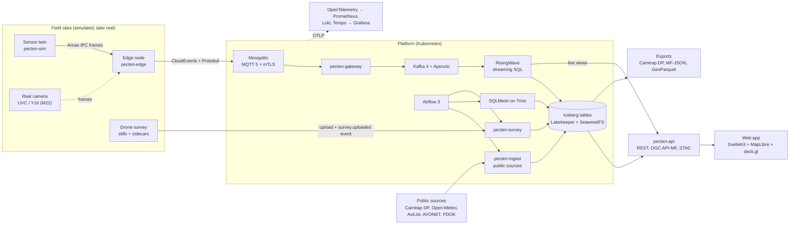
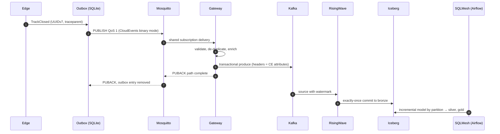

# Architecture

> Target architecture as planned on 2 November 2026. Parts are built milestone by milestone
> ([ROADMAP.md](../ROADMAP.md)); this page is updated when a decision changes.

## 1. Overview

Pecten turns camera frames into trustworthy, privacy-safe bird-monitoring data. It has four
parts:

1. **Sensor twin** (`pecten-sim`, Python): renders visible-light, thermal, stereo-thermal and
   drone imagery from physics, with ground truth on a separate channel.
2. **Edge** (`pecten-edge`, Rust): one process per camera or camera pair. Deterministic
   detection, tracking and flight characterisation; only events leave the device.
3. **Platform:** MQTT broker and gateway, Kafka, RisingWave, an Iceberg lakehouse (Lakekeeper on
   S3-compatible storage), Trino, SQLMesh, Airflow and public-source connectors.
4. **Product surface:** a read API (REST, OGC API – Moving Features, STAC), a web app, exports in
   ecological and geospatial standards, and Grafana for operations.

## 2. System context



## 3. The edge pipeline

```mermaid
flowchart LR
  SRC["Frame source<br/>Arrow IPC · file replay · V4L2"] --> MASK["Privacy mask<br/>(pixels zeroed)"]
  MASK --> PRE["Pre-processing<br/>dead pixels · FFC handling · radiometric scale"]
  PRE --> BG["Background model<br/>EMA · running median · sky percentile"]
  BG --> FG["Foreground<br/>contrast-to-noise · hysteresis"]
  FG --> CCL["Morphology +<br/>connected components"]
  CCL --> REJ["Distractor rules<br/>insects · rain · blades · cloud edges"]
  REJ --> GUARD["Human-signature guard"]
  GUARD --> TRK["Tracker<br/>Kalman · gating · Kuhn–Munkres"]
  TRK --> ST["Stereo association<br/>triangulation (pairs only)"]
  ST --> FEAT["Flight features<br/>speed · wingbeat · size · mode"]
  FEAT --> RULES["Explainable rules<br/>size class · behaviour · reason codes"]
  RULES --> OUT["Outbox (SQLite)<br/>→ MQTT 5 publisher"]
  PRE -. "health" .-> TEL["Heartbeats + OTel metrics"]
  GUARD -. "counts only" .-> OUT
```



Per modality:

| Modality | Background | Detection | Tracking | Characterisation |
| :-- | :-- | :-- | :-- | :-- |
| Thermal (mono) | Sky percentile per pixel; reset on FFC | ΔT over sky with hysteresis | 2-D Kalman | Angular speed, wingbeat (Nyquist-aware), size from assumed range |
| Thermal (stereo pair) | As above, per camera | As above | 2-D per camera, then epipolar association | 3-D position and speed, altitude band, rotor-zone crossing |
| Visible light (fixed) | EMA with selective update; illumination-change reset | Absolute difference over robust noise | 2-D Kalman | Visits, dwell time, flock size |
| Drone (nadir stills) | None (single frames) | Difference of Gaussians or top-hat at GSD-derived scale; thermal hot spots | Cross-image geometric de-duplication | Georeferenced individuals and nests |

## 4. Events and contracts

| Event (`type`) | Emitted when | Key fields |
| :-- | :-- | :-- |
| `org.pecten.detection.batch.v1` | Per frame with detections (thinned) | frame time, blobs (centroid, area, contrast), reasons |
| `org.pecten.track.updated.v1` | Track state changes, at most 5 Hz | track ID, state, position, velocity, covariance summary |
| `org.pecten.track.closed.v1` | Track ends | smoothed path, features, size class, reason codes |
| `org.pecten.device.heartbeat.v1` | Every 10 s | frame rate, drops, latency, sensor temperature, clock status |
| `org.pecten.privacy.suppressed.v1` | Guard fires | region, count, duration (no pixels) |
| `org.pecten.advisory.issued.v1` | Platform rule fires | site, rule, inputs, hysteresis state |
| `org.pecten.survey.uploaded.v1` | Drone survey upload completes | survey ID, image count, mission ID |

Topics: MQTT `pecten/v1/{site}/{device}/{stream}`; Kafka `pecten.{entity}.v1`, partitioned by
device. Every payload is a Protobuf message registered in Apicurio. Contracts: [ADR-0011](adr/0011-contracts-first.md).

## 5. The lakehouse

| Namespace | Example tables | Written by | Retention |
| :-- | :-- | :-- | :-- |
| `raw` | landing manifests, minimised source files | `pecten-ingest` | until superseded |
| `bronze` | `track_updates`, `tracks_closed`, `detections`, `heartbeats`, `privacy_suppressions` | RisingWave | 14 days |
| `silver` | `tracks`, `device_minutes`, `camtrap_observations`, `weather_hourly`, `survey_detections` | SQLMesh, `pecten-survey` | 1 year |
| `gold` | `passage_rates`, `rotor_zone_flux`, `collision_risk`, `diel_activity`, `colony_counts` | SQLMesh | kept |
| `ref` | `devices`, `sites`, `species`, `species_traits`, `protected_areas`, `rules` | registry loader, connectors | versioned |
| `ops` | `dq_results`, `lineage_events`, `budget_usage`, `reconciliation` | Airflow, services | 90 days |

Partitioning by `day(event_time)` and `bucket(device_id)`; every export and release pins snapshot
IDs; maintenance jobs expire snapshots and remove orphan files.

## 6. An event's life



If the link drops, the outbox keeps events (bounded by size and age) and replays them in order
after reconnecting. Duplicates created by retries are removed by event ID in the gateway and again
in the staging models.

## 7. Deployment

| Environment | How | Used for |
| :-- | :-- | :-- |
| Compose | `just up <profile>`: `core`, `stream`, `batch`, `obs`, `full` | Everyday development |
| CI | kind cluster per run, scenario-driven end-to-end test | Every pull request touching runtime code |
| Local clusters | k3d `platform` + k3d `edge` (three simulated sites), Argo CD | GitOps, rollouts, failure drills |
| Real edge (M22) | K3s or Docker on a Raspberry Pi 5-class arm64 device | Real-sensor readiness |
| Cloud demo (optional, M21) | OpenTofu, disposable single node | Public demonstration |

## 8. Repository layout (target)

```text
crates/            Rust workspace: pecten-vision, pecten-edge, pecten-gateway, pecten-proto, pecten-py
packages/          uv workspace: pecten-sim, pecten-ingest, pecten-pipelines, pecten-survey,
                   pecten-api, pecten-contracts
proto/             Protobuf schemas (buf)
contracts/         ODCS data contracts
streaming/         RisingWave SQL migrations
transform/         SQLMesh project
scenarios/         Simulator scenario files
registry/          Sites, devices, calibrations, privacy masks, rule tables
web/               SvelteKit application
deploy/            compose/, helm/, argocd/, policies/, tofu/
observability/     dashboards, alert rules, SLO specs
docs/              research, ADRs, architecture, tutorials, how-tos, reference, runbooks
tools/             repository tooling (dependency policy, roadmap sync)
```

## 9. Quality targets

| Attribute | Target | Verified by |
| :-- | :-- | :-- |
| Edge throughput | 640 × 512 thermal at 30 fps on one Cortex-A76-class core | criterion benchmark on arm64 CI (M6.9) |
| Detection | Recall ≥ 0.95 for targets ≥ 3 px and contrast-to-noise ≥ 8 in the reference scenarios | twin verification (M6.8) |
| Tracking | ≤ 1 identity switch per 100 tracks in the reference scenarios | twin verification (M7.7) |
| Stereo altitude | Error within the `δZ ∝ Z²` model ± 20 % up to 300 m | twin verification (M7.6) |
| Edge to bronze | p95 latency < 5 s when online; no loss after a 6-hour outage | chaos tests (M9.6) |
| Freshness | Gold tables < 1 h behind bronze, p95 | SLO (M20.4) |
| Footprint | Full local lakehouse ≤ 2 GB; CI end-to-end ≤ 100 MB | budget checks (M10.7) |
| Privacy | Zero person-like events in privacy scenarios | M14.7 |

## 10. Trust boundaries

1. **Device boundary:** frames never cross it. Devices authenticate with short-lived client
   certificates and may publish only to their own topics.
2. **Ingestion boundary:** third-party data is minimised before the first write.
3. **Platform boundary:** services use workload identities and catalog-vended, short-lived
   storage credentials; secrets come from SOPS-encrypted manifests.
4. **Public boundary:** the API is read-only and anonymous; there are no user accounts.

A STRIDE threat model and a privacy note are written in M23.2.
